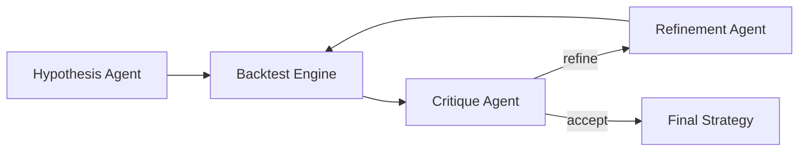

# AgentQuant

A research-focused agentic trading system that generates, backtests, critiques, and refines stock trading hypotheses using a multi-step AI workflow.

## Overview

AgentQuant explores whether a loop of:

- hypothesis generation
- rule-based backtesting
- critique and rejection checks
- refinement and re-testing

can produce stronger trading strategies than a single-shot baseline.

The project uses historical Indian equity data, a deterministic backtest engine, and a lightweight multi-agent loop built around LangGraph and LLM-based reasoning.

## Why this project

This repository is designed as a clean research prototype and portfolio project for:

- agentic workflow design
- quantitative strategy evaluation
- LLM-assisted research loops
- structured experimentation with memory and critique

It is intended for experimentation and learning, not financial advice.

## Project structure

```text
AgentQuant/
├── agents/
│   ├── critique_agent.py
│   ├── hypothesis_agent.py
│   └── refinement_agent.py
├── backtest/
│   └── engine.py
├── data_layer/
│   ├── cache/
│   └── fetch_prices.py
├── memory/
│   ├── chroma_db/
│   ├── agentquant.db
│   ├── log_store.py
│   └── vector_store.py
├── report/
│   └── dashboard.py
├── .env.example
├── .gitignore
├── LICENSE
├── README.md
├── evaluate.py
├── graph.py
├── main_baseline.py
├── pyproject.toml
├── requirements.txt
├── schema.py
├── variance_check.py
└── .venv/           # local only, not tracked
```

## Core workflow



## Features

- LLM-generated technical trading rules
- qualitative critique and refinement loop
- deterministic strategy backtesting
- train/test split for research discipline
- persistent SQLite and ChromaDB memory
- Streamlit dashboard for reviewing attempts
- Python package metadata for installability

## Tech stack

- Python 3.10+
- LangGraph
- LangChain / OpenAI
- pandas / NumPy
- yfinance
- ChromaDB
- SQLite
- Streamlit

## Quick start

1. Create a virtual environment

```bash
python -m venv .venv
source .venv/bin/activate
# Windows PowerShell:
# .\.venv\Scripts\Activate.ps1
```

2. Install dependencies

```bash
pip install -r requirements.txt
```

3. Configure environment

```bash
copy .env.example .env
```

Then update `.env`:

```env
OPENAI_API_KEY=your_openai_api_key_here
```

4. Run the baseline strategy

```bash
python main_baseline.py
```

5. Run the iterative research loop

```bash
python graph.py
```

6. Open the dashboard

```bash
streamlit run report/dashboard.py
```

## Research notes

The project intentionally emphasizes experimentation and research reproducibility over production-grade trading infrastructure.

## License

This project is licensed under the MIT License. See `LICENSE` for details.

## GitHub publish

From the repository root:

```bash
git add .
git commit -m "Initial project cleanup and publish-ready setup"
git branch -M main
git remote add origin https://github.com/<your-username>/AgentQuant.git
git push -u origin main
```

If you want a private repository instead of public, replace the remote URL with your private GitHub repo URL.
